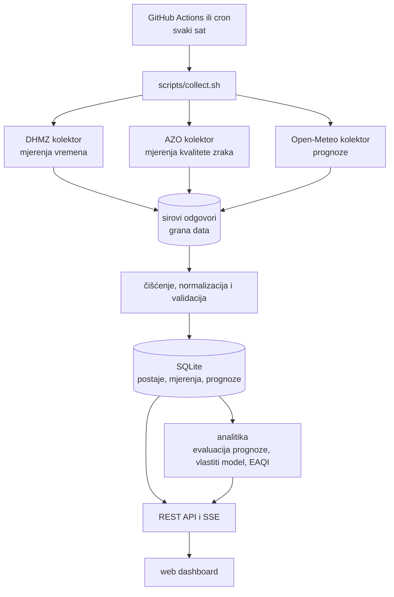

# ZrakHR

[](https://github.com/Matej2405/ZrakHR/actions/workflows/web.yml)
[](https://github.com/Matej2405/ZrakHR/actions/workflows/python.yml)
[](https://github.com/Matej2405/ZrakHR/actions/workflows/scripts.yml)
[](https://github.com/Matej2405/ZrakHR/actions/workflows/collect.yml)

Sustav koji svaki sat prikuplja izmjerene podatke o vremenu (DHMZ) i kvaliteti zraka (AZO) za
hrvatske gradove, uz prognoze s Open-Meteo, čisti ih, sprema i prikazuje na web dashboardu.

Semestralni projekt iz kolegija **Programiranje skriptnih jezika** (RITEH).

- Dashboard: https://matej2405.github.io/ZrakHR/
- Plan i tiketi: [GitHub Project](https://github.com/users/Matej2405/projects/4)

## Istraživačko pitanje

Kako vremenski uvjeti (temperatura, relativna vlažnost, tlak zraka i vjetar) utječu na
koncentracije lebdećih čestica PM10 i PM2.5 u hrvatskim gradovima i koliko je točna prognoza
zagađenja u usporedbi s izmjerenim vrijednostima?

Gradovi obuhvaćeni projektom: Zagreb, Rijeka, Split, Osijek i Slavonski Brod.

## Tim

| Član           | GitHub                                       | Zaduženja                                                     |
| -------------- | -------------------------------------------- | ------------------------------------------------------------- |
| Matej Brodarac | [Matej2405](https://github.com/Matej2405)    | web dashboard, izvještaji, dokumentacija i prezentacija       |
| Bruno Bezjak   | [Bruno0211](https://github.com/Bruno0211)    | skriptni dio: kolektori, pohrana, REST API i analitika        |

## Izvori podataka

| Izvor                                                   | Što daje                                                                                  | Uloga u projektu                                                                                              |
| ------------------------------------------------------- | ----------------------------------------------------------------------------------------- | ------------------------------------------------------------------------------------------------------------- |
| [DHMZ](https://vrijeme.hr/hrvatska_n.xml)               | trenutno vrijeme sa 60 do 75 postaja, ovisno o satu: temperatura, vlažnost, tlak i vjetar (XML) | **mjerenja**; feed sadrži samo tekući sat, pa povijest nastaje isključivo satnim prikupljanjem                |
| [AZO, Kvaliteta zraka u RH](https://iszz.azo.hr/iskzl/) | koncentracije PM10, PM2.5, NO₂ i O₃ sa službenih mjernih postaja (REST, JSON/XML)          | **mjerenja**; portal čuva povijest, pa se podaci mogu dohvatiti i unatrag                                       |
| [Open-Meteo](https://open-meteo.com/)                   | prognoza vremena i CAMS prognoza PM10 i PM2.5 za koordinate grada                         | **samo prognoza**: CAMS je model na mreži od oko 11 km, a ne mjerenje; prognoze se čuvaju radi usporedbe s mjerenjima |

Nakon povratne informacije nastavnika Open-Meteo više nije izvor mjerenja nego samo prognoze, a
HNB-ova tečajna lista izbačena je iz projekta.

## Tehnologije

Skriptni dio je središnji dio projekta: prikupljanje, čišćenje, pohrana i analiza podataka
napisani su u Pythonu i Bashu.

- **Python 3.10+**: kolektori (`requests`), čišćenje i normalizacija, pohrana u SQLite, REST API
  (FastAPI) i SSE, analitika
- **Bash i PowerShell**: skripte za pokretanje i periodičko izvršavanje (`scripts/collect.sh` za
  cron i GitHub Actions)
- **GitHub Actions**: satno prikupljanje podataka, provjere na svakom pull requestu i objava
  dashboarda na GitHub Pages
- **TypeScript (React i Vite)**: web dashboard. Nastavnik je TypeScript za sučelje dopustio uz
  uvjet da skriptni jezik ostane bitan dio projekta. Detalji su u [`web/README.md`](web/README.md).

## Arhitektura



Svi izvori normaliziraju se u isti oblik zapisa: `{source, location, metric, timestamp, value,
unit}`. Metrike nose iste nazive kao kod Open-Meteo (npr. `temperature_2m`, `wind_speed_10m`), a
jedinica je zapisana uz svaku vrijednost, pa se mjerenja i prognoze lako uspoređuju. Vrijednosti
koje ne prođu provjeru (npr. vlažnost 0 %) odbacuju se i bilježe s razlogom.

| Mapa                 | Sadržaj                                                           |
| -------------------- | ----------------------------------------------------------------- |
| `src/zrakhr/`        | Python paket: kolektori (`collectors/`), gradovi, naredbeni redak |
| `scripts/`           | Bash skripte za prikupljanje i pokretanje                         |
| `tests/`             | pytest testovi i primjeri stvarnih podataka (`tests/fixtures/`)   |
| `api/`               | REST API i SSE                                                    |
| `web/`               | web dashboard                                                     |
| `docs/`              | dokumentacija                                                     |
| `.github/workflows/` | provjere, satno prikupljanje i objava dashboarda                  |

## Plan po kontrolnim točkama

| KT      | Datum       | Cilj                                                                                                                                                   |
| ------- | ----------- | ------------------------------------------------------------------------------------------------------------------------------------------------------ |
| KT I    | 1.11.2026.  | Struktura repozitorija, README, prototip kolektora s naredbenim retkom                                                                                 |
| KT II   | 27.11.2026. | DHMZ i AZO kolektori, satno prikupljanje, SQLite shema, Open-Meteo samo za prognozu; okvir dashboarda i karta postaja                                  |
| KT III  | 18.12.2026. | Pridruživanje postaja gradovima, provjere kvalitete podataka, REST API i SSE, dohvat povijesti; grafovi, prikaz uživo i karta obojena prema PM10       |
| KT IV   | 22.1.2027.  | Evaluacija CAMS prognoze, vlastiti model za PM10, analiza utjecaja vremena, indeks kvalitete zraka (EAQI), pravila upozorenja, Bash i PowerShell skripte |
| Završno | 4.2.2027.   | Završno izvješće i dokumentacija; obrana 11.2.2027.                                                                                                    |

Tiketi po iteracijama i njihovo stanje su na [GitHub Projectu](https://github.com/users/Matej2405/projects/4).

## Pokretanje

Potreban je Python 3.10 ili noviji (provjera: `python3 --version`).

macOS / Linux (Bash):

```bash
git clone https://github.com/Matej2405/ZrakHR.git
cd ZrakHR
python3 -m venv .venv
source .venv/bin/activate
python -m pip install --upgrade pip
pip install -r requirements.txt
pip install -e .
```

Windows (PowerShell):

```powershell
git clone https://github.com/Matej2405/ZrakHR.git
cd ZrakHR
py -m venv .venv
.venv\Scripts\Activate.ps1
python -m pip install --upgrade pip
pip install -r requirements.txt
pip install -e .
```

`pip install -e .` instalira paket `zrakhr` iz `src/` u načinu za razvoj, pa
izmjene koda vrijede odmah, bez ponovne instalacije.

Dohvat podataka iz korijena repozitorija, s aktiviranim venvom:

```bash
python -m zrakhr collect --source dhmz     # tekući sat DHMZ-ovih mjerenja
python -m zrakhr fetch --city Zagreb       # Open-Meteo prognoza za jedan grad
python -m zrakhr fetch --city "Slavonski Brod"
```

`collect` sprema sirovi XML u `data/raw/dhmz_<vrijeme opažanja>.xml` i ispisuje broj postaja,
zapisa i odbačenih vrijednosti, uz razlog za svaku odbačenu. `fetch` sprema sirove odgovore u
`data/raw/<izvor>_<grad>_<vrijeme dohvata>.json`. Podržani gradovi: Zagreb, Rijeka, Split, Osijek,
Slavonski Brod. Sve opcije: `python -m zrakhr --help`.

Testovi:

```bash
pytest
```

Virtualno okruženje se isključuje naredbom `deactivate`.

## Prikupljanje podataka

Podatke svaki sat prikuplja workflow [Collect](.github/workflows/collect.yml) na GitHub Actionsu:
DHMZ mjerenja u :20 i :50 (dvaput na sat, jer GitHubov raspored zna kasniti), a Open-Meteo
prognoze svakih 6 sati. Sirovi odgovori spremaju se u granu
[`data`](https://github.com/Matej2405/ZrakHR/tree/data), koja služi kao arhiva. Arhiva je u
zasebnoj grani jer računalo na kojem se workflow izvodi nakon svakog pokretanja nestaje, a sirovi
podaci se ne commitaju u `main`.

Arhiva se lokalno otvara u zasebnoj mapi, bez promjene trenutne grane:

```bash
git fetch origin data
git worktree add ../zrakhr-data data
```

Ista skripta radi i lokalno ili iz crona na stalno upaljenom računalu:

```bash
scripts/collect.sh dhmz data        # u data/raw/dhmz/ i log u data/logs/
scripts/collect.sh forecasts data   # u data/raw/open-meteo/
```

Na Windowsima skripta radi u Git Bashu ili WSL-u.

## Web dashboard

React, TypeScript i Vite u mapi `web/`. Nakon svakog mergea u `main` dashboard se automatski
objavljuje na https://matej2405.github.io/ZrakHR/. Lokalno (potreban je Node.js 24):

```bash
cd web
npm ci
npm run dev   # http://localhost:5173
```

Naredbe, struktura i odluke o alatima opisani su u [`web/README.md`](web/README.md).

## Provjere i CI

Svaki pull request pokreće provjere za dio repozitorija koji mijenja:

| Workflow | Provjere                                                                   |
| -------- | -------------------------------------------------------------------------- |
| Python   | pytest na Pythonu 3.10 do 3.15                                             |
| Web      | lint, provjera tipova, testovi s pokrivenošću i build                      |
| Scripts  | ShellCheck za Bash skripte i actionlint za same workflowe                  |
| PR title | naslov PR-a prati Conventional Commits (`feat:`, `fix:`, `docs:` …)        |
| Labels   | oznake frontend, backend, docs i infra prema mapama koje PR mijenja        |

Dependabot jednom mjesečno predlaže ažuriranja ovisnosti, a CODEOWNERS svaki pull request
automatski šalje na pregled drugom članu tima.
